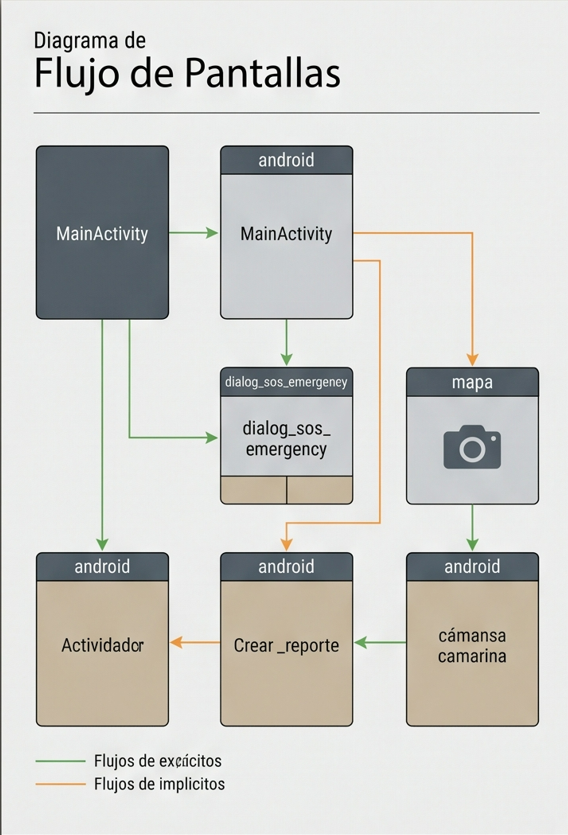
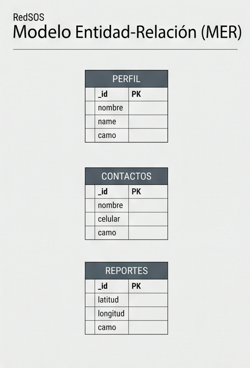
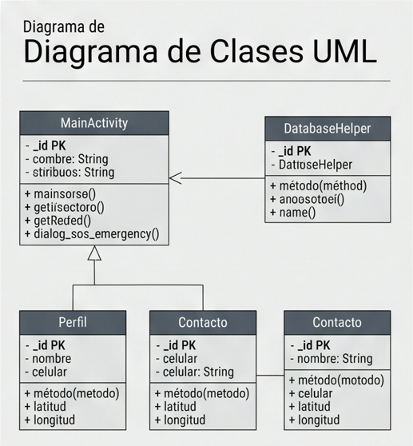
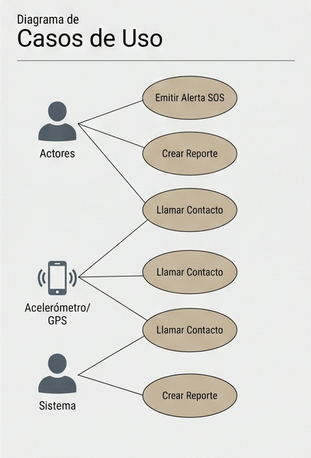

# RedSOS — Alerta y Conexión Comunitaria ante Catástrofes

Aplicación Android de emergencia pensada para funcionar cuando la comunicación normal falla (terremotos, catástrofes). Permite reportar incidentes en un mapa, avisar a contactos de emergencia y confirmar tu estado de seguridad, guardando todo localmente en el celular.

## Ficha del Proyecto

- **Nombre de la app:** RedSOS
- **Estudiante:** Jesus Armando León Vásquez
- **Sede:** Instituto Profesional Santo Tomás
- **Asignatura:** Programación Android (IEI-093)

### Objetivos de la app

- Establecer canales de comunicación resilientes durante catástrofes, cuando los servicios móviles tradicionales colapsan.
- Proporcionar un mapa colaborativo para identificar zonas de peligro y puntos críticos de ayuda (albergues, centros de acopio).
- Facilitar el rastreo de seguridad familiar mediante avisos de ubicación y estado vital.

### Descripción

RedSOS es una aplicación Android de emergencia. Permite reportar incidentes con foto de evidencia en un mapa interactivo, llevar un perfil con datos médicos importantes (tipo de sangre, alergias, enfermedades, medicamentos), gestionar contactos de emergencia con opción de llamada, y detectar sacudidas sísmicas con el acelerómetro para activar un check-in de seguridad. Todos los datos se guardan en una base de datos SQLite local, con executor en segundo plano para evitar que la app se congele.

## Funcionalidades

- **Mapa colaborativo** con marcadores de albergues, zonas de peligro, puntos de agua y ayuda
- **Reporte de incidentes con foto de evidencia** (cámara del sistema + FileProvider) que se guarda en SQLite y aparece en el mapa
- **Check-in de seguridad automático**: si el acelerómetro detecta una sacudida fuerte, se abre un diálogo para confirmar si estás bien
- **Contactos de emergencia** con CRUD completo (crear, leer, actualizar, eliminar) y llamada directa
- **Perfil del usuario** con datos personales y médicos (tipo de sangre, alergias, enfermedades, medicamentos, contacto de emergencia)
- **GPS con FusedLocationProviderClient** para geolocalización precisa
- **Consulta de números de emergencia** (Carabineros 133, SAMU 131, Bomberos 132)

## Stack técnico

- **Lenguaje:** Java
- **Base de datos:** SQLite con `SQLiteOpenHelper` + Clase Contrato (`BaseColumns`)
- **Mapas:** Google Maps SDK (`SupportMapFragment` + `OnMapReadyCallback`)
- **GPS:** `FusedLocationProviderClient` (Play Services Location)
- **UI:** ConstraintLayout, RecyclerView (Adapter + ViewHolder), CardView, Material Design, Chips
- **Sensores:** Acelerómetro con `SensorEventListener`
- **Multihilo:** `ExecutorService` (hilos secundarios para BD y cámara, sin ANR)
- **Cámara:** `ACTION_IMAGE_CAPTURE` con URI segura de `FileProvider`
- **Seguridad:** consultas parametrizadas (`selectionArgs`), `exported="false"`, `FLAG_SECURE` en pantallas sensibles

## Documentación técnica

### Diagrama de flujo de pantallas (UI Flow)



### Modelo Entidad-Relación de la base de datos (ERD)



### Diagrama de clases UML



### Diagrama de casos de uso



## Estructura del Proyecto

```
com.example.redsos/
├── MainActivity.java          ← Pantalla principal: mapa, botones SOS y sensor
├── mapa.java                  ← Mapa con marcadores desde SQLite + cámara
├── contactos.java             ← Lista de contactos con RecyclerView
├── agregarcontacto.java       ← Formulario para agregar contactos
├── informacion.java           ← Perfil del usuario (datos médicos)
├── auxilios.java              ← Información de auxilios
├── dialog_sos_emergency.java  ← Alerta SOS
├── MiUbicacion.java           ← GPS con FusedLocationProviderClient
├── adapters/
│   └── ContactoAdapter.java   ← Adapter del RecyclerView de contactos
└── db/
    ├── ContratoRedSOS.java    ← Clase Contrato (tablas y columnas)
    ├── RedSOSDbHelper.java    ← SQLiteOpenHelper (onCreate/onUpgrade)
    └── RedSOSDb.java          ← Operaciones CRUD (ContentValues + Cursor)
```

## Guía de instalación

1. Clonar este repositorio:
   ```
   git clone https://github.com/JesusLeonV/RedSOS.git
   ```
2. Abrir la carpeta en **Android Studio**
3. Pedir una **API Key de Google Maps** en [Google Cloud Console](https://console.cloud.google.com/) y agregarla en `local.properties`:
   ```
   MAPS_API_KEY=TU_API_KEY_AQUI
   ```
4. Sincronizar Gradle (**Sync Now**)
5. Ejecutar en un dispositivo real o emulador (mínimo Android 10 / API 29)

## Permisos usados

- `ACCESS_FINE_LOCATION` / `ACCESS_COARSE_LOCATION` — geolocalización del usuario
- `INTERNET` / `ACCESS_NETWORK_STATE` — tiles del mapa de Google

> Aplicamos el principio de mínimo privilegio: solo se declaran los permisos que el código usa hoy.

## Seguridad implementada

- Consultas SQL con argumentos parametrizados (`selectionArgs`) para evitar inyección SQL
- `android:exported="false"` en todas las activities privadas
- `FileProvider` con URIs `content://` seguras para la cámara
- `FLAG_SECURE` en la pantalla de datos médicos y en la alerta SOS (bloquea capturas)
- Auditoría de permisos: se removieron los que no se usaban

## Autor

**Jesús Armando León Vásquez**
Instituto Profesional Santo Tomás
Programación Android (IEI-093)
